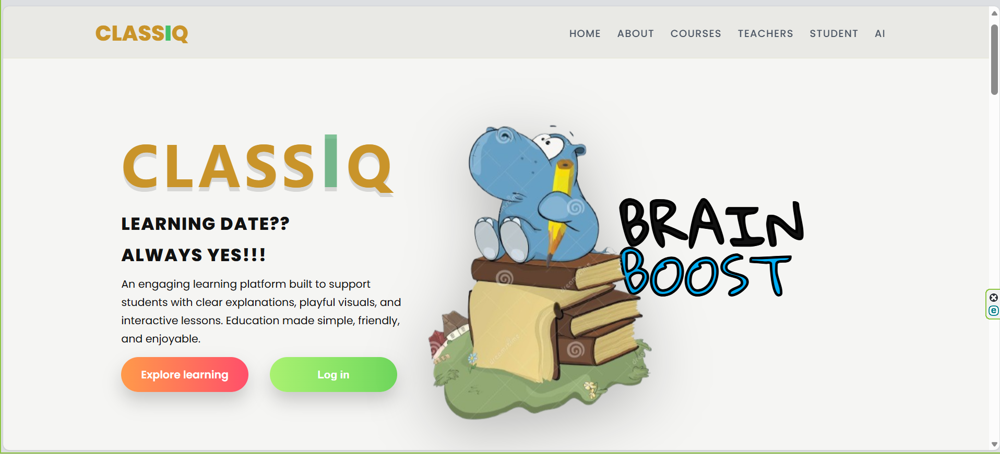
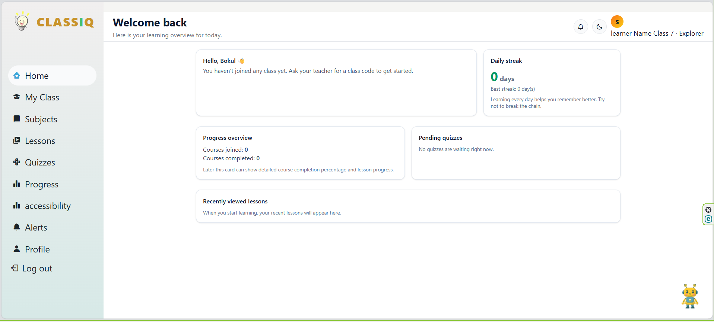
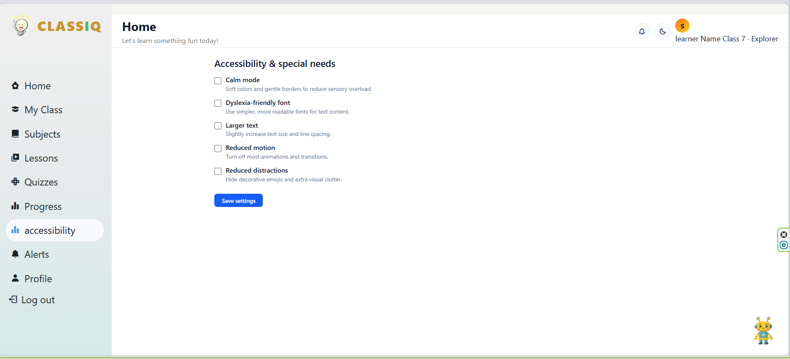
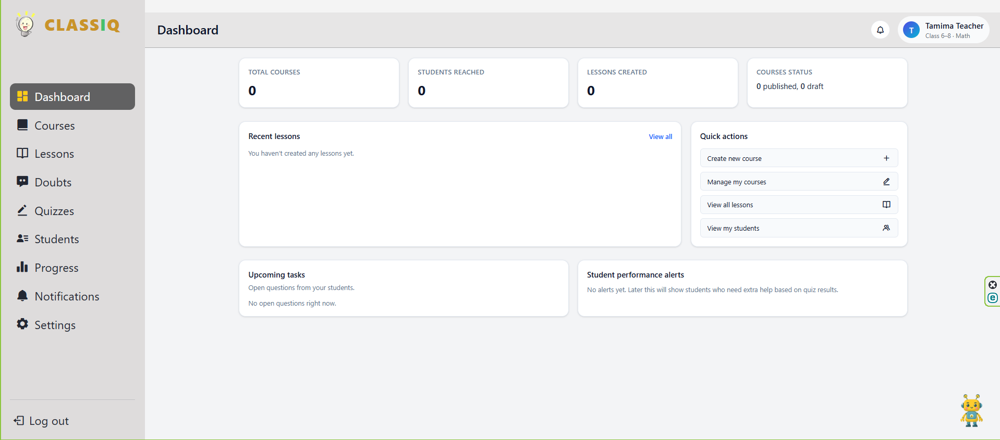
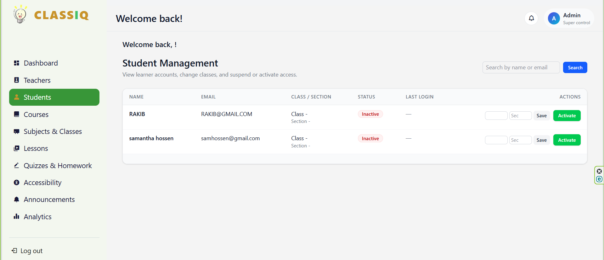
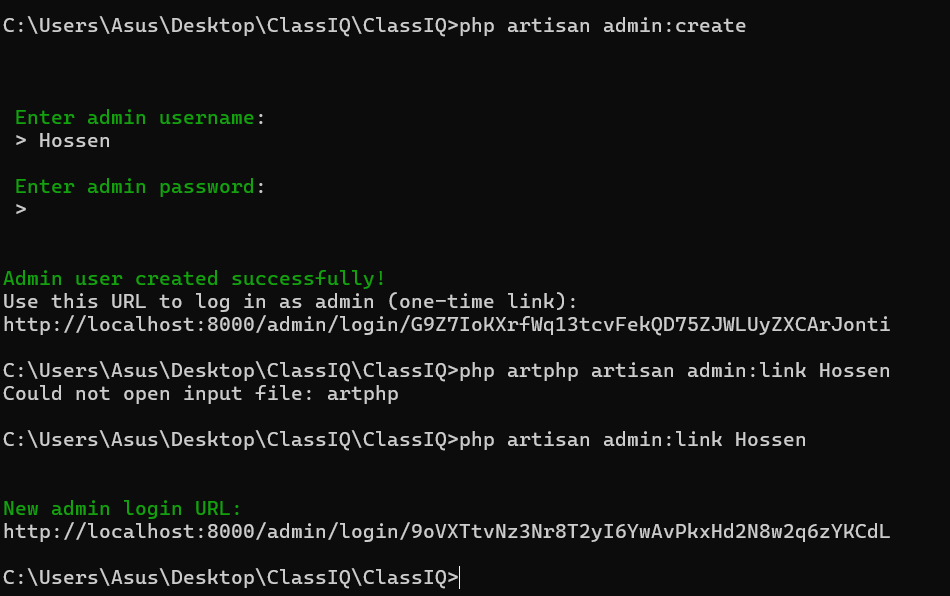
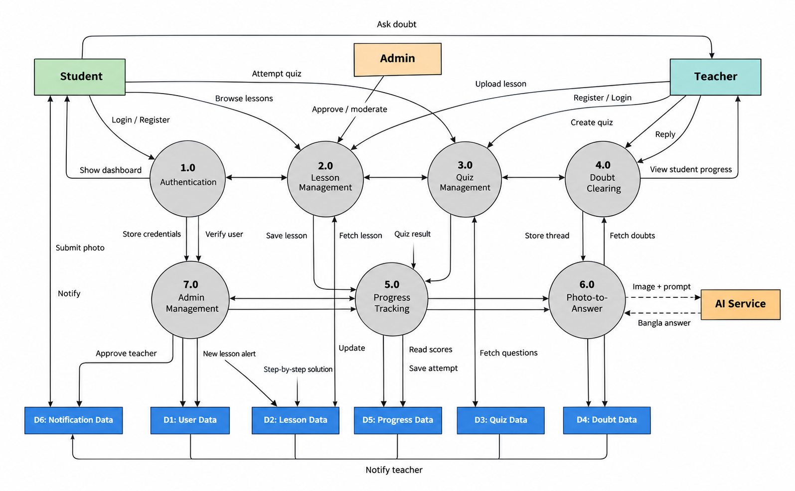

<div align="center">



# ClassIQ

### *Learning date?? Always yes!!!*

**An AI-powered learning platform built for Bangladeshi students — bringing classrooms to anyone with a phone.**

[](https://www.php.net/)
[](https://laravel.com/)
[](https://tailwindcss.com/)
[](https://www.mysql.com/)
[](#license)
[]()

</div>

---

## About the project

Bangladesh's classrooms are crowded, teachers are stretched thin, and most of the best learning material online is in English. Students fall back on memorisation because real one-to-one help is out of reach.

**ClassIQ** is our attempt at closing that gap. A student points their camera at a question they can't solve; the platform explains it step by step in Bangla. Teachers upload lessons, run quizzes that grade themselves, and answer doubts in a thread tied to the exact lesson a student got stuck on. For learners who need it, the whole interface can switch to calm mode, dyslexia-friendly fonts, larger text, reduced motion.

It was built as our **Design Project (II)** for the Bachelor of Science in Computer Science and Engineering at the **University of Liberal Arts Bangladesh (ULAB)** — Fall 2025.

> *"Education made simple, friendly, and enjoyable."*

---

## Table of contents

- [Key features](#key-features)
- [Screenshots](#screenshots)
- [Tech stack](#tech-stack)
- [System architecture](#system-architecture)
- [Modules](#modules)
- [Getting started](#getting-started)
- [Project structure](#project-structure)
- [Database](#database)
- [Roadmap](#roadmap)
- [Team](#team)
- [Acknowledgements](#acknowledgements)
- [License](#license)

---

## Key features

### For students
- **📸 Photo-to-Answer** — snap a photo of a question, receive a step-by-step explanation in Bangla
- **🔊 Lessons with voice** — text-to-speech reads lessons aloud for students who learn better by listening
- **📝 Auto-generated quizzes** — practice questions are built from lesson content, graded instantly
- **📊 Progress tracking** — daily streaks, completion stats, performance breakdowns
- **💬 Ask your teacher** — submit doubts under the exact lesson, get threaded replies
- **♿ Accessibility built in** — calm mode, dyslexia-friendly fonts, reduced motion, larger text

### For teachers
- **📚 Course and lesson builder** — structure content into courses → chapters → topics → lessons
- **🎥 Rich lessons** — attach videos, summaries, vocabulary, supplementary resources
- **🔑 Class codes** — enrol a whole classroom with one generated code
- **📬 Doubt inbox** — all student questions in one dashboard, grouped by lesson
- **📈 Student insights** — see who's falling behind before it becomes a problem

### For admins
- **✅ Teacher approval workflow** — review documents, approve or reject registrations
- **🛠️ Content moderation** — approve, feature, or hide any course, chapter, topic, or lesson
- **👥 Learner management** — move students between classes, configure system-wide settings
- **🔐 Secure bootstrap** — admin accounts are created from the command line, logged in via one-time links

---

## Screenshots

### Landing page


### Student dashboard

Students get a focused home screen — daily streak, courses joined, pending quizzes, recently viewed lessons.



### Accessibility for special-needs learners

Calm mode, dyslexia-friendly font, larger text, reduced motion, reduced distractions — all toggleable per student.



### Teacher dashboard

Teachers see their course count, lesson count, student reach, and a quick-actions panel to spin up new content.



### Admin: teacher approval

Admins vet each teacher before they go live — checking submitted documents, toggling status between active, suspended, and rejected.



### Admin bootstrap (CLI)

The first admin isn't created through the UI — it's provisioned via Artisan with a one-time login URL.



---

## Tech stack

| Layer | Choice | Why |
|---|---|---|
| **Backend** | Laravel (PHP 8.1+) | Fast to build with, multi-guard auth fits our three user roles, Eloquent keeps queries readable |
| **Frontend** | Blade + Tailwind CSS | Server-rendered means no SPA complexity, Tailwind lets us ship a clean look without hand-written CSS |
| **Database** | MySQL | Bundled with XAMPP, which every teammate already had |
| **Charts** | Chart.js | Lightweight, no React dependency |
| **AI** | External API (photo-to-answer + Bangla translation) | Integrated through Laravel controllers |
| **Local dev** | XAMPP (Apache + MySQL) | One installer per machine |
| **Dependencies** | Composer (PHP), npm (JS) | Standard tooling |
| **Version control** | Git + GitHub | This repository |

---

## System architecture

The platform follows a classic MVC pattern with role-based route middleware guarding access between Admin, Teacher, and Learner surfaces.



---

## Modules

| Module | What it does | Implementation |
|---|---|---|
| **Authentication** | Separate login flows for Admin, Teacher, Learner | Laravel multi-guard, email verification for teachers, token-based for admins |
| **Admin** | Teacher onboarding, content moderation, system settings | Role-scoped dashboard, soft-toggle status flags |
| **Teacher** | Course → Chapter → Topic → Lesson hierarchy, doubt replies | Eloquent relationships, class code generation |
| **Learner** | Browse enrolled courses, watch lessons, take quizzes | Accessibility preferences stored per user |
| **Lesson Management** | CRUD lessons with video, summary, resources | Laravel controllers + Blade views |
| **Quiz & Assessment** | Auto-generated questions, instant grading | Scored server-side, results stored per learner |
| **Photo-to-Answer** | Image upload → AI → step-by-step Bangla solution | AI API called from Laravel backend |
| **Doubt-Clearing** | Per-lesson Q&A thread between learner and teacher | Linked to `lesson_id` + `learner_id` + `teacher_id`, status toggles open → answered |
| **Progress Tracking** | Course completion, streaks, performance | Eloquent aggregates, visualised with Chart.js |
| **Notifications** | New lessons, quiz deadlines, replies | Laravel Notifications (email + in-app) |

---

## Getting started

### Prerequisites

Before you clone, make sure you have:

- **PHP** 8.1 or newer — check with `php -v`
- **Composer** — check with `composer -V`
- **Node.js** 18+ and **npm** — check with `node -v` and `npm -v`
- **MySQL** 5.7+ (comes with XAMPP)
- **Git**

Easiest way to get PHP + MySQL + Apache in one installer: [XAMPP](https://www.apachefriends.org/).

### Installation

```bash
# 1. Clone the repo
git clone https://github.com/Samantha-panda/ClassIQ.git
cd ClassIQ

# 2. Install PHP dependencies
composer install

# 3. Install JavaScript dependencies
npm install

# 4. Copy the environment template and generate the app key
cp .env.example .env
php artisan key:generate

# 5. Edit .env with your own values:
#    DB_DATABASE=classiq
#    DB_USERNAME=root
#    DB_PASSWORD=
#    MAIL_MAILER=smtp
#    MAIL_HOST=...
#    (plus your AI API key if applicable)

# 6. Create the database in phpMyAdmin, then run migrations
php artisan migrate --seed

# 7. Compile frontend assets
npm run build
# (or `npm run dev` while developing, for hot reload)

# 8. Start the dev server
php artisan serve
```

Open **[http://localhost:8000](http://localhost:8000)** in your browser.

### Creating the first admin

The first admin is bootstrapped from the command line:

```bash
php artisan admin:create
```

It will prompt for a username and password, then print a one-time login URL. Open that URL in your browser to sign in as admin — regenerate the link any time with `php artisan admin:link <username>`.

### Running tests

```bash
php artisan test
```

---

## Project structure

```
ClassIQ/
├── app/
│   ├── Http/
│   │   ├── Controllers/        # Admin, Teacher, Learner, Auth controllers
│   │   └── Middleware/         # Role guards
│   ├── Models/                 # Eloquent models (User, Course, Lesson, Quiz, Doubt, …)
│   └── Notifications/          # Email + in-app alerts
├── config/                     # Laravel config
├── database/
│   ├── migrations/             # Schema definitions
│   ├── factories/              # Test data factories
│   └── seeders/                # Starter content
├── public/                     # Entry point (index.php), compiled assets
├── resources/
│   ├── views/                  # Blade templates
│   │   ├── admin/
│   │   ├── teacher/
│   │   ├── learner/
│   │   └── layouts/
│   ├── css/                    # Tailwind source
│   └── js/                     # Frontend scripts
├── routes/
│   ├── web.php                 # Web routes
│   └── api.php                 # API routes (if any)
├── storage/
│   ├── app/                    # File uploads (lesson resources, submitted photos)
│   └── logs/                   # Laravel logs
├── tests/                      # Automated tests
├── .env.example                # Template for environment config
├── .gitignore
├── artisan                     # Laravel CLI
├── composer.json
├── package.json
└── README.md                   # ← you are here
```

---

## Database

The entity relationships below show how users, courses, lessons, quizzes, and doubts hang together.


Key tables:

- `users` — stores Admin, Teacher, Learner (role-scoped)
- `courses`, `chapters`, `topics`, `lessons` — four-level content hierarchy
- `enrollments` — links Learner ↔ Course via class code
- `quizzes`, `questions`, `quiz_attempts` — assessment layer
- `doubts` — threaded Q&A per lesson
- `notifications` — Laravel's default notifications table

---

## Roadmap

Future Implementation:

- **Mobile app** (React Native) — most Bangladeshi students access the internet from phones
- **Offline mode** — download lessons and quizzes for low-connectivity areas
- **Teacher analytics** — class-wide performance heatmaps per topic
- **Peer-to-peer doubt clearing** — let students help each other, moderated by the teacher
- **More subjects** — currently tuned for secondary-level; extend to primary and higher-secondary
- **Voice-first interface** — ask questions by speaking, in Bangla
- **Integrations with NCTB curriculum** — auto-align lessons to the national textbook

---


## License


---

<div align="center">

**Built with ☕, late nights, and a lot of Composer errors.**

[Report an issue](https://github.com/Samantha-panda/ClassIQ/issues) · [Request a feature](https://github.com/Samantha-panda/ClassIQ/issues/new)

</div>